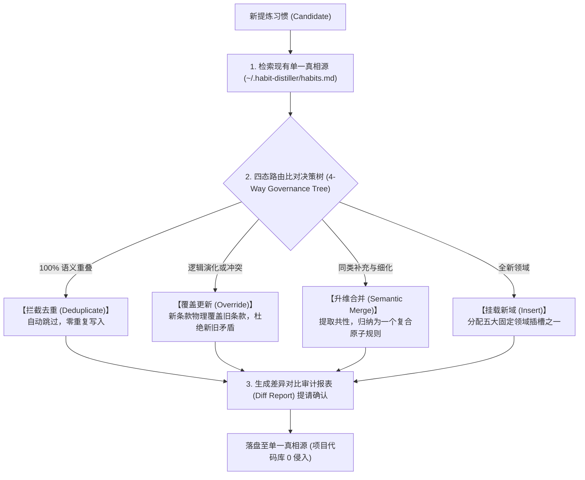

# Habit Distiller Skills (零侵入全局伴生习惯与防熵增治理系统)

<p align="left">
  
  
  
  
  
</p>

[**简体中文**](#-中文文档) | [**English**](#-english-documentation)

---

## 🇨🇳 中文文档

**Habit Distiller Skills** 是一个面向现代 AI IDE / Agent（如 Trae、Claude Code、Cursor、Antigravity、Windsurf 等）的**零侵入全局伴生习惯管理与防熵增生命周期治理框架**。

遵循 **第一性原理** 与 **KISS 原则**，它彻底解决了人机协同中的“反复纠偏”与“类似 Hermes 技能爆炸混乱”痛点。坚决杜绝侵入式篡改项目代码库（如 `CLAUDE.md`、`.cursorrules`），并通过独创的**四态治理决策树**实现习惯的“自动去重、新旧更替、同类升维合并”，使个人习惯集始终维持在 5~8 条黄金原子原则。

### 🌟 核心突破：如何杜绝“Hermes 碎片化混乱”？

传统 Agent 的习惯记录通常只是粗暴的 `Append（追加）`，随着时间推移必然出现：新旧冲突、同义反复、条目膨胀。Habit Distiller 引入了 **Habit Governor（防熵增治理引擎）**：



### 🗂️ 五大固定领域插槽 (Domain Taxonomy)

所有习惯必须归入以下五大插槽，严格收敛控制上下文预算：
1. 🧠 **`[DOMAIN: COGNITION]` 认知推演与设计前瞻**：主动多想 1~2 步，推演潜在缺陷与生命周期盲区，协助降低设计缺陷概率；
2. 🛡️ **`[DOMAIN: DEFECT]` 缺陷修复与防线规范**：连带确凿缺陷无破坏一并彻底修复；
3. 📡 **`[DOMAIN: PROGRESS]` 运行过程可观测性**：长流程或批处理时输出步骤心跳微反馈；
4. 📊 **`[DOMAIN: DELIVERY]` 终态交付展示规范**：双轨看板、Before/After 对照表；
5. 🌐 **`[DOMAIN: DOCS]` 工程资产与文档规范**：面向公开项目，文档默认中英双语、中文置顶。

### 🚀 安装与使用

#### 1. 一键全局安装（推荐）
通过 Vercel `skills` CLI 一键全局安装：

```bash
npx skills add Ikaros-521/habit-distiller-skills -g
```

或使用本地挂载脚本：
```powershell
# Windows
.\scripts\sync.ps1 -Target install-global

# Linux / macOS
./scripts/sync.sh install-global
```

#### 2. 在对话中随时提炼新习惯
在任何 AI IDE 会话中发送：
> “提炼刚才的对话习惯”

AI 会自动触发治理引擎，比对去重、冲突更新或同类合并，经您审核后落盘至 `~/.habit-distiller/habits.md`。

---

## 🇺🇸 English Documentation

**Habit Distiller Skills** is a zero-intrusion, sidecar habit management and anti-entropy lifecycle governance framework designed for modern AI IDEs and agents (Trae, Claude Code, Cursor, Antigravity, Windsurf, etc.).

Grounded in **First Principles** and the **KISS Principle**, it tackles repeated alignment friction while eliminating the notorious **"Hermes Rule Explosion"**—where unconstrained additions lead to bloat, conflict, and confusion. It never mutates project-level rule files, and employs a **4-Way Governance Decision Tree** to automatically deduplicate, override, and semantically merge developer habits into 5~8 golden atomic rules.

### 🌟 Solving the "Hermes Fragmentation Dilemma"

- **The Problem with Naive Appends**: Stacking instructions sequentially leads to mutual contradictions, synonym bloat, and context degradation.
- **The Habit Governor Engine**:
  - ⏭️ **Deduplicate**: 100% semantic overlaps are skipped automatically.
  - 🔄 **Override**: New practices physically supersede obsolete rules to prevent conflict.
  - 🔀 **Semantic Merge**: Granular habits in the same domain are unified into consolidated principles.
  - ➕ **Insert**: Genuinely new practices are slotted into one of five fixed domains.

### 🗂️ Five Fixed Domain Slots

1. 🧠 **`[DOMAIN: COGNITION]` Foresight & Blind-Spot Exploration**: Think 1~2 steps ahead to catch potential lifecycle and architectural flaws.
2. 🛡️ **`[DOMAIN: DEFECT]` Chain Bug Sweep**: Eliminate verified collateral bugs thoroughly without causing regression.
3. 📡 **`[DOMAIN: PROGRESS]` Observable In-Flight Feedback**: Real-time step heartbeat during multi-step runs.
4. 📊 **`[DOMAIN: DELIVERY]` Dual-Track Dashboard**: High-readability Before/After summaries and IDE Artifacts.
5. 🌐 **`[DOMAIN: DOCS]` Bilingual Documentation**: Symmetrical bilingual READMEs (Chinese default + English) for open-source repositories.

### 🚀 Installation & Sync

```bash
npx skills add Ikaros-521/habit-distiller-skills -g
```

---

## 📄 License
[MIT License](LICENSE) © 2026 LuoXi
