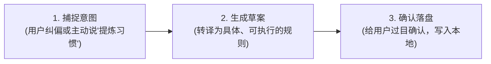

# Habit Extractor: 个人习惯协助提炼引擎 (KISS 版)

本文档定义了 AI 如何在日常对话中**协助开发者提炼个人协同习惯**，并将其沉淀为清晰可执行的准则。

---

## 1. 核心目标与原则

- **目标唯一**：协助开发者提炼**“期望模型怎么干活的协同契约”**（例如：连带修复确凿缺陷、简单问题秒回无废话、复杂任务给对比看板）。
- **防过拟合**：仅提炼通用的工作流与协作要求，不提炼一次性的具体业务代码逻辑（如“这次用冒泡排序”不是习惯）。
- **不确定就反问**：当用户提出的要求较模糊或为纯负向约束（“不要做 X”）时，主动向用户反问澄清具体期望，支持回复“强制写入”直接放行。

---

## 2. 协助提炼的标准三步法 (SOP)



### 第一步：捕捉意图
- 场景 A：用户明确发出指令，如“`提炼习惯：以后涉及公开项目，README 必须中英双语`”；
- 场景 B：用户多次指出同类问题，如“`别只改这一处，把关联的几个地方一起修了`”。

### 第二步：生成草案向用户提请确认
AI 将用户的意图整理为 1 条精炼规则，输出给用户确认：
```markdown
### 🎯 协同习惯提炼建议

- **规则名称**：[例如：缺陷连带清零]
- **期望模型的干活方式**：[具体、明确、可执行的行动要求]
- **适用范围**：[global / 特定语言]

请问是否按上述内容沉淀为习惯？（可直接回复确认，或提出修改意见）
```

### 第三步：确认后安全写入
经用户确认后，AI 执行写入流程：
1. 写入前自动生成镜像备份 `~/.habit-distiller/habits.md.bak`；
2. 将规则精简保存至 `~/.habit-distiller/habits.md`；
3. 输出简洁反馈：“✅ 已为您沉淀该习惯，后续所有会话均将遵循。”
