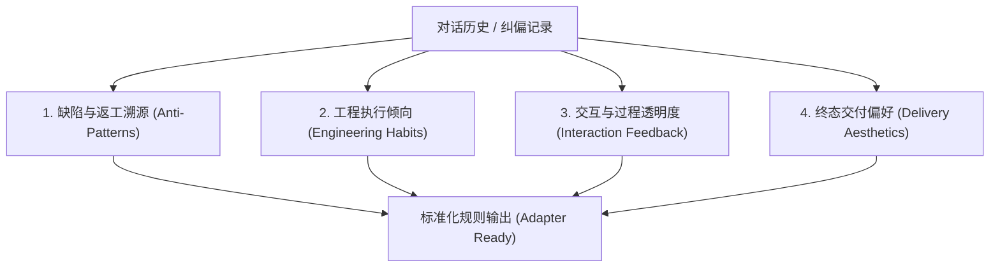

# Habit Distiller Core: 习惯逆向提炼引擎

本文档定义了 AI 逆向分析用户与 AI 交互历史、提炼个人专属开发习惯并转化为可执行规则的元提示词（Meta-Prompt）与标准作业程序（SOP）。

---

## 1. 触发场景

- **指令唤起**：用户输入“提炼对话习惯”、“沉淀习惯”、“分析刚才的返工原因”或在 IDE 中触发 `/habit-distiller`。
- **自动纠偏唤起**：当一轮对话发生 2 次以上方案推翻或用户明确指出“你又犯了老毛病/我的习惯是...”时。

---

## 2. 提炼分析四维模型 (4D Habit Extraction Matrix)

AI 必须立足于**第一性原理**，审查最近 5~20 轮对话上下文或用户指定的历史记录，从以下四个维度执行剖析：



### 维度一：缺陷与返工溯源 (Anti-Patterns)
- **分析重点**：AI 在哪里被用户打断？哪部分代码被推倒重来？
- **根因判定**：是因为防御性设计过度（违背 KISS）？还是修改 A 功能破坏了 B 功能？亦或是只修了表面 Bug 留下了连锁暗坑？

### 维度二：工程执行倾向 (Engineering Habits)
- **分析重点**：
  - **Bug 修复边界**：用户倾向于“仅修报障点”还是“连锁确凿 Bug 顺藤摸瓜一并彻底修复”？
  - **架构偏好**：极简直观 (KISS) vs 抽象设计模式？
  - **改动范围**：外科手术式微调 vs 大范围重构？

### 维度三：交互与过程透明度 (Interaction Feedback)
- **分析重点**：用户对大模型执行过程的耐心程度与排查需求。
  - 是否反感“黑盒长静默”？
  - 是否需要在执行读写、测试、排查步骤时给出**微心跳阶段反馈**？

### 维度四：终态交付偏好 (Delivery Aesthetics)
- **分析重点**：
  - 交付结构（如 STE 规范、Before/After 对照表、Mermaid 流程图、Artifacts 看板）。
  - 语言与术语标准（如默认中文、双语 README 等）。

---

## 3. 习惯固化提炼模板（输出给用户审核）

提炼完成后，AI **严禁**直接静默修改底层规则，必须按照以下格式向用户提请审核：

```markdown
### 🎯 对话习惯提炼与沉淀建议

#### 【发现的返工根因】
- [问题描述] -> [导致反复沟通的痛点]

#### 【提炼出的习惯规则（拟新增）】
1. **[规则命名]**：[具体、可执行、无歧义的行为准则，必须包含触发条件与边界]
2. **[规则命名]**：[具体准则]

#### 【落盘存储目标推荐】
请选择您希望保存的位置（回复对应序号）：
- [1] **当前项目生效**（写入当前工程根目录规则文件）
- [2] **本机全局生效**（写入您当前 IDE 的用户全局家目录）
```

---

## 4. 新用户落盘定位树 (Target Storage Resolution Tree)

当新用户批准写入规则时，AI 依据其**当前运行的 IDE 环境**与**用户的选项（项目级 vs 全局）**，精准定位落盘路径：

| 当前 AI IDE 环境 | 选项 1：当前项目级生效路径 | 选项 2：本机全局级生效路径 |
| :--- | :--- | :--- |
| **Trae (字节跳动)** | `<当前工程>/.trae/rules.md` | `~/.trae/rules.md` |
| **Claude Code** | `<当前工程>/CLAUDE.md` | `~/.claude/CLAUDE.md` |
| **Cursor** | `<当前工程>/.cursorrules` | `~/.cursor/rules/personal.mdc` |
| **Windsurf** | `<当前工程>/.windsurfrules` | `~/.codeium/windsurf/memories/global_rules.md` |
| **DeepSeek (dsh)** | `<当前工程>/.dsh/rules.md` | `~/.dsh/config.toml` |
| **OpenCode** | `<当前工程>/.opencode/rules.md` | `~/.opencode/rules.md` |
| **Antigravity / Gemini** | `<当前工程>/GEMINI.md` | `~/.gemini/GEMINI.md` |
| **ZCode** | `<当前工程>/.zcode/rules.md` | `~/.zcode/rules.md` |
| **Qoder** | `<当前工程>/.qoderules` | `~/.qoder/rules.md` |
| **Codex / Copilot** | `<当前工程>/.github/copilot-instructions.md` | VS Code 全局扩展自定义指令 |

> 💡 **安全底线**：无论新用户存到项目级还是全局级，均属于其**本地私有文件**，绝不会触碰或修改 `habit-distiller-skills` 源码仓库，杜绝数据外泄。
