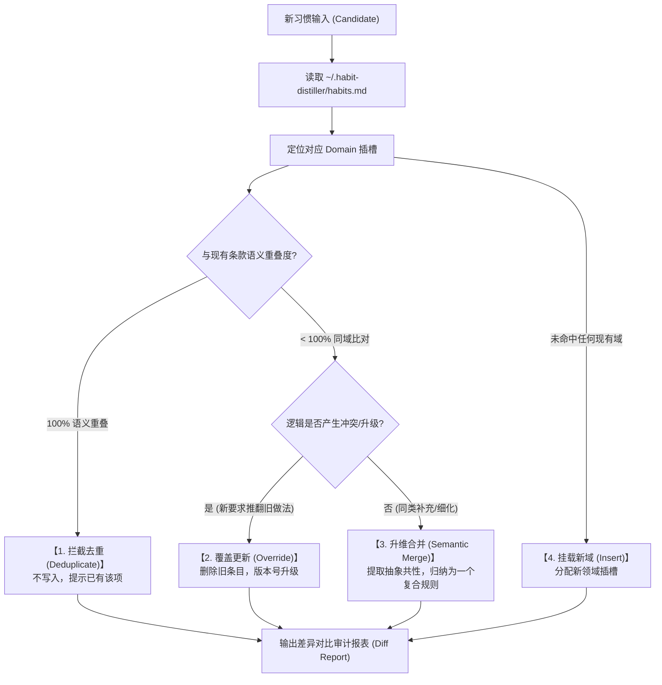

# Habit Governor: 习惯生命周期治理与防熵增引擎

本文档定义了 Habit Distiller 如何在提炼个人习惯时进行**去重、版本覆盖、语义同类合并与防膨胀收敛**的治理标准作业程序（SOP），彻底解决类似 Hermes 技能爆炸和碎片化冲突问题。

---

## 1. 核心治理理念与目标

- **痛点 (The Anti-Pattern)**：传统 Agent 习惯提取只做无脑 `Append（末尾追加）`，经过多轮演化后必然导致：
  1. **规则冲突**：新习惯与旧习惯互相打架；
  2. **冗余膨胀**：同义反复，过度消耗模型上下文 Token；
  3. **零散割裂**：十几个碎片规则让 Agent 无所适从、频发幻觉。
- **治理目标**：**“有域可归、同类必并、冲突必替、精炼收敛”**。全局规则总量始终收敛控制在 **5~8 条黄金原子原则**内。

---

## 2. 领域分类插槽 (Domain Taxonomy)

所有提取的习惯必须归入以下五大核心领域插槽之一，严禁无序堆放：

| 领域插槽 (Domain ID) | 覆盖范围与职责 | 治理典型示例 |
| :--- | :--- | :--- |
| `[DOMAIN: COGNITION]` | **认知推演与设计前瞻** | 前瞻性发散思考、盲区探索、架构推演 |
| `[DOMAIN: DEFECT]` | **缺陷修复与防线规范** | 连带缺陷清零、证据确凿、零回归保证 |
| `[DOMAIN: PROGRESS]` | **运行过程可观测性** | 步骤心跳微反馈、排查事实即时回传 |
| `[DOMAIN: DELIVERY]` | **终态交付展示规范** | 双轨看板、Before/After 对照表、Artifacts |
| `[DOMAIN: DOCS]` | **工程资产与文档规范** | 开源双语 README、中文置顶、结构对称 |

---

## 3. 四态路由比对决策树 (4-Way Governance Decision Tree)

当用户提出新习惯意向或 AI 尝试提炼时，**严禁直接追加**，必须先读取 `~/.habit-distiller/habits.md`，执行以下决策树：



### 1. 拦截去重 (Deduplicate)
- **触发**：新提炼的内容已在现有条款的覆盖范围内。
- **动作**：零写入，向用户说明已有对应保障。

### 2. 覆盖更替 (Override)
- **触发**：新偏好与旧条款存在互斥或演进更替（如：“以前要详细长文，现在只要步骤微反馈”）。
- **动作**：物理覆盖旧条款，更新版本时间戳，杜绝新旧矛盾。

### 3. 升维合并 (Semantic Merge)
- **触发**：新偏好与旧条款属于同一领域的不同侧面（如“写 Python 要类型注解”与“写 TS 严禁 any”）。
- **动作**：禁止分裂成两条规则，必须归纳升维为一条高阶抽象规则（如“【强类型与防错规范】”）。

### 4. 挂载新域 (Insert)
- **触发**：开辟了全新的领域（如首次加入国际化规范）。
- **动作**：在领域插槽中建立新章节。

---

## 4. 提炼时的变更差异审计报表 (Diff Audit Report)

提炼完成后，AI 必须向用户呈现清晰的 Diff 对比，征得用户同意后再落地：

```markdown
### 📊 习惯治理审计报表 (Habit Governance Diff)

- 🔀 【升维合并】: [DOMAIN: ...] 将旧项 A 与新项 B 合并归纳为 C
- 🔄 【覆盖更新】: [DOMAIN: ...] 新条款已替代旧条款 (旧版逻辑已物理剔除)
- ⏭️ 【拦截去重】: [DOMAIN: ...] 检测到与既有规则完全重叠，已自动去重
- ➕ 【新增挂载】: [DOMAIN: ...] 新增领域独立条目
```
